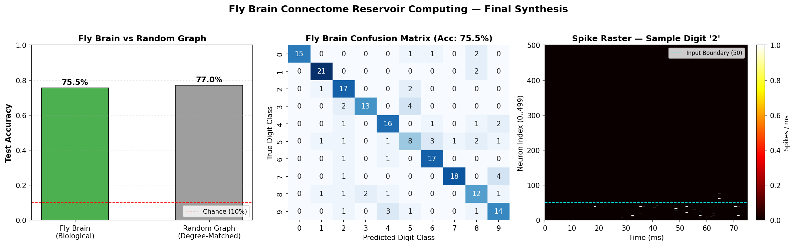

# Drosophila Connectome Spiking Reservoir

Spiking neural network (LIF) reservoir computing using the biological connectome of *Drosophila melanogaster* (MaleCNS v1.0) to classify handwritten digits from MNIST.



## Overview

This project explores whether unoptimized biological neural wiring extracted directly from the fruit fly visual system (right medulla, `ME(R)`) can serve as a computational reservoir for image classification.

- **Connectome Source**: Janelia Research Campus & Google DeepMind MaleCNS (`male-cns:v1.0`)
- **Neurons**: 500 biological neurons (50 sensory input channels, 450 recurrent units)
- **Synapses**: 19,455 directed biological connections (density: 7.78%)
- **Dynamics**: Leaky Integrate-and-Fire (LIF) spiking network implemented in Brian2
- **Readout**: Multinomial Logistic Regression on spike count features

## Results

| Model / Architecture | Test Accuracy | 5-Fold CV Accuracy | Recurrent Spikes |
|---|---|---|---|
| **Chance Baseline** | 10.00% | 10.00% | — |
| **Raw 50-D Input (No Reservoir)** | 81.00% | — | — |
| **Degree-Matched Random Graph** | 77.00% | 80.10% ± 2.45% | 0 spikes |
| **Biological Fly Brain (MaleCNS)** | **75.50%** | **77.60% ± 3.68%** | **4,187 spikes** |

### Key Finding: The Columnar Clustering Effect
- In the biological connectome, 4,187 spikes actively cascaded into downstream recurrent neurons due to spatial columnar convergence in the medulla.
- In the degree-matched random graph, uniform dispersion of connections diluted synaptic potentials below threshold, leaving downstream units silent (0 spikes).

For the full scientific analysis, see [`report.md`](report.md).

## Installation

1. Clone the repository:
```bash
git clone https://github.com/your-username/flybrain-reservoir.git
cd flybrain-reservoir
```

2. Create and activate a virtual environment:
```bash
python -m venv venv
# Windows:
venv\Scripts\activate
# Linux/macOS:
source venv/bin/activate
```

3. Install required packages:
```bash
pip install neuprint-python brian2 torch torchvision scikit-learn numpy matplotlib seaborn pandas
```

4. Configure neuPrint credentials:
Copy `.env.example` to `.env` and insert your auth token from [neuprint.janelia.org](https://neuprint.janelia.org):
```bash
cp .env.example .env
```

## Running the Pipeline

The pipeline is organized into modular scripts that can be executed sequentially:

```bash
# 1. Pull the 500-neuron subcircuit from neuPrint MaleCNS
python 01_pull_connectome.py

# 2. Simulate LIF network and calibrate dynamics
python 02_lif_simulation.py

# 3. Verify contrast-adaptive input encoding
python 03_input_encoding.py

# 4. Extract spike count features across 1,000 MNIST images
python 04_feature_extraction.py --samples 1000

# 5. Train and evaluate the linear readout classifier
python 05_train_classifier.py

# 6. Run the degree-matched random graph baseline
python 06_random_baseline.py --seed 42 --samples 1000

# 7. Generate final synthesis figures
python 07_visualize.py
```

## Repository Structure

```
├── 01_pull_connectome.py     # Connectome API query & weight matrix extraction
├── 02_lif_simulation.py      # Brian2 LIF spiking simulation
├── 03_input_encoding.py      # Contrast-adaptive photoreceptor encoding
├── 04_feature_extraction.py   # High-throughput batch spike extraction
├── 05_train_classifier.py     # Linear readout classifier & cross-validation
├── 06_random_baseline.py      # Degree-matched random graph comparison
├── 07_visualize.py           # 3-panel synthesis visualization
├── report.md                 # Detailed scientific report
├── fly_brain_classifier.png  # Master summary figure
├── .env.example              # Template for API credentials
└── .gitignore                # Protects secrets and large binary data
```

## References

- Takemura et al., Janelia Research Campus & Google (2023). *A Connectome of the Male Drosophila Central Nervous System*.
- Stimberg et al. (2019). *Brian 2, an intuitive and efficient neural simulator*. eLife.
- LeCun et al. (1998). *The MNIST Database of Handwritten Digits*.
